# 中路 Solo 灰盒验证记录

验证日期为 2026 年 10 月 9 日。当前交付已加入森林地图样稿与局部镜头；单位仍使用灰盒像素资源，正式美术、地形碰撞与最终玩法平衡仍在后续阶段。

## 工程验证

| 检查 | 结果 |
| --- | --- |
| npm install | 安装成功，安装时审计未发现漏洞 |
| npm test | 37 项测试全部通过（23 项比赛、8 项镜头与 6 项地图测试） |
| npm run build | TypeScript 检查和 Vite 生产构建通过 |
| 生产构建运行 | 本地 preview 能加载游戏画布并开始对局，观察到的控制台无警告或错误 |
| .env | 已被 Git 忽略，游戏代码不引用资源生成密钥 |

## 自动化测试覆盖

- 英雄击杀和防御塔处决均触发一血结算。
- 防御塔摧毁触发一塔结算。
- 只计算英雄最后一击，达到 100 刀结算，重复伤害不重复计数。
- 小兵和防御塔击杀不计入英雄补刀。
- 同一逻辑步双方英雄死亡判平局，同一方多条件达成时按规则选择结束原因。
- 结束后停止时间、出兵、伤害和玩家指令。
- 移动取消未完成普攻前摇，前摇完成后释放追踪弹道。
- Q 命中首个敌人后消失，采用线段扫掠判定防止高速穿过目标。
- E 先预警后结算范围伤害，一次效果可完成多个补刀。
- 技能冷却、法力消耗、W 减伤与边界限制。
- 防御塔优先攻击小兵，英雄攻击塔下敌方英雄后转移仇恨，目标离开范围后重新选目标。
- 暂停冻结时间、移动、出兵和冷却；新比赛清空原有状态。
- 180 秒确定性模拟后状态数值有效、实体数量保持有界。
- AI 低血量后撤，敌方英雄进入压力范围时释放 Q。
- 默认局部视口、2× / 3× 地图边界、平移 / 重锁 / 重开，以及镜头空间与世界空间的双向坐标转换。
- 高刷新率的亚像素平移累计，不会因取整停滞或加速。
- 平移并缩放镜头后，移动与 W 仍使用转换后的世界坐标。

## 浏览器实操

本地开发版本验证了开始对局、右键移动、普攻补刀反馈、Q 和 E 消耗与冷却、左键查看单位血量、暂停和恢复。一局实际交战触发一血失败结算，显示结束原因、用时和双方补刀数。

连续点击重新开局三次，三次均显示双方补刀为 0、时间为 00:00、玩家生命为 640、法力为 240，并重新等待第一波兵线。

在默认窗口、1440 × 1000 和 800 × 900 的浏览器视口检查布局。在宽屏下，480 × 270 逻辑画布显示为 960 × 540；800 像素宽窗口无页面水平溢出。测试结束恢复默认视口。观察到的开发版和生产版控制台均无警告或错误。

## 后续验收

一塔和 100 刀胜负目前通过自动化规则测试验证，仍需人工完成这两种取胜路线并检查对局节奏。基础 AI 已可交战，难度、兵线数值和技能平衡尚未定稿。60 FPS 性能目标、更多浏览器兼容性、正式资源与音乐仍需在最终展示阶段验收。

## 森林地图与镜头迭代

第一张地图样稿以原生 511 × 327 像素接入，未修改原始 PNG；视口仍为 480 × 270，默认 2× 镜头只显示 240 × 135 的世界区域。蓝红防御塔叠加在中路上，原图两端圆形平台作为恢复点。小地图是示意图，不是降采样后的地图素材。

开发版浏览器实操确认了：独立蓝红塔显示、Y 自由 / 跟随切换、自由镜头下右键移动、英雄移动时镜头保持不变、小地图跳转查看敌方塔、空格回英雄且保持自由模式、滚轮 3× 放大、按住方向键平移和重开恢复默认视角。观察到的控制台没有警告或错误。中键拖动与贴边平移已实现，仍建议人工试玩其手感。

本次生产构建也能加载森林背景与独立塔并开始对局，观察到的控制台无警告或错误。800 × 900 视口下页面宽度与滚动宽度均为 800，没有水平溢出；测试后已恢复默认视口。

环境底图目前没有精细岩壁 / 河道碰撞、遮挡层或复杂寻路网格；这次不把风格样稿视为最终关卡验收。英雄、小兵与防御塔动画仍待制作。

## 镜头调远

根据试玩反馈，默认镜头从 2× 调整为 1.5×，可见世界区域从 240 × 135 扩大到 320 × 180。角色相对视口缩小 25%，视野宽高各增加约 33%；滚轮范围同步改为 1.5× / 2×，新比赛也恢复 1.5×。更新后的 31 项测试与生产构建通过。开发版实际画面显示 1.5×，小地图视野框宽度为 320，观察到的控制台无警告或错误。

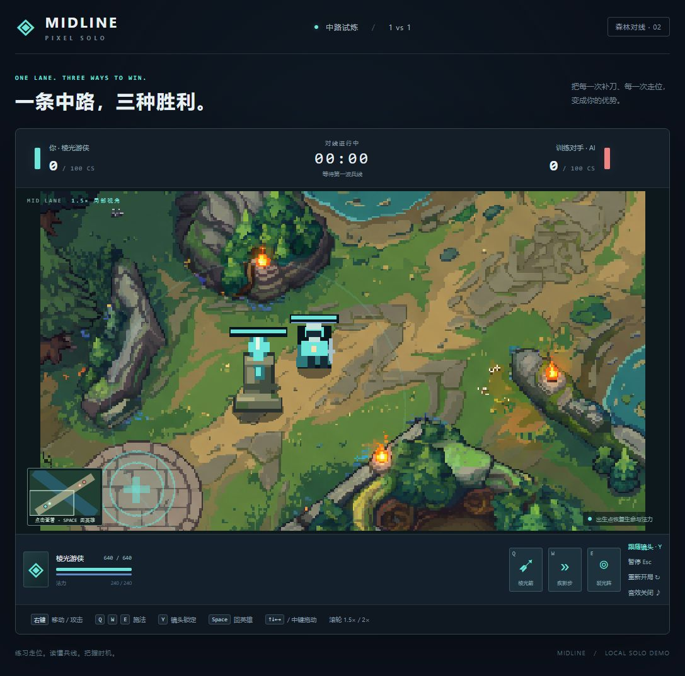

## 首次迭代截图

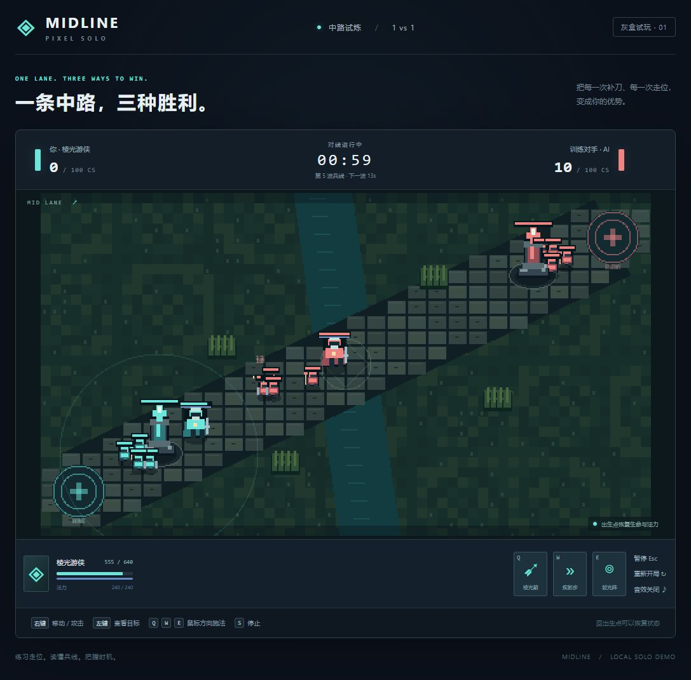

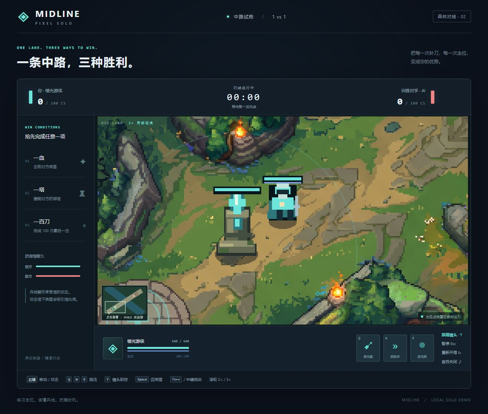

## 地图空间扩容

根据上下走位空间不足的反馈，将原生 511 × 327 底图在世界中按整数 2 倍、最近邻采样铺设，实际地图变为 1022 × 654。原始 PNG 不变，角色与塔的尺寸、移动速度、技能和攻击范围、1.5× / 2× 镜头均保持不变。实际道路与地图余量同步增大，塔位、恢复点、出生点、AI 站位和小地图同步使用扩容坐标。恢复区域随地形放大，AI 在恢复区内持续恢复的判断也已对齐。

新增测试覆盖实际地图尺寸、角色 / 镜头比例不变、关键点对齐、出生点上下均有超过 150 世界单位的空间、英雄上下跨越原 327 像素地图边界、兵线从新恢复点正确前进，以及 AI 在扩大的恢复区继续恢复。37 项测试全部通过。

浏览器确认了更宽的路面、1022 × 654 小地图世界、默认 320 × 180 局部视野、右键向上 / 向下走位和镜头跟随，观察到的控制台无警告或错误。兵速与 14 秒出兵间隔未改，兵线抵达中央更慢，节奏需后续试玩调节。精细地形碰撞与遮挡仍未实现。

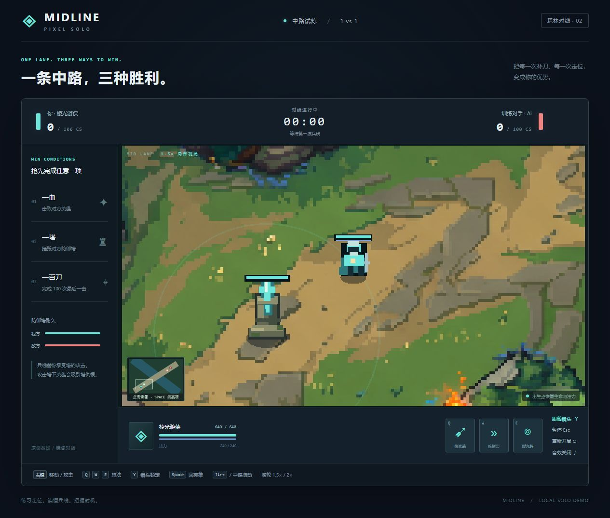

## 再次扩大镜头视野

根据视野仍偏窄的反馈，将默认镜头从 1.5× 拉远至 1×，可见世界区域从 320 × 180 增至 480 × 270，宽高各增加 50%，面积为上一版的 2.25 倍。角色显示尺寸缩小约三分之一；实际地图 1022 × 654、单位尺寸、移速、攻击范围和技能数据保持不变。滚轮现在在 1× / 1.5× 之间切换，新比赛恢复 1×。

更新后的 37 项测试与生产构建通过，覆盖两个缩放档位的地图边界、平移、重开和世界坐标转换。浏览器实际确认默认 1×、小地图视野框 480 × 270，滚轮拉近后为 1.5× / 320 × 180，拉远后正确恢复。右键向上走位后，英雄从约 (290, 482) 移至 (290, 428)，小地图视野框随英雄移动，观察到的控制台无警告或错误。

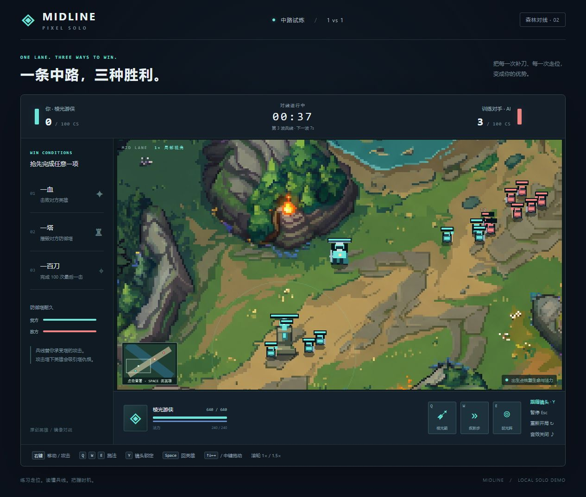

## 八向迈步样稿与连续角度验证

通过项目 game-assets Skill 的像素多视角能力，生成亚索、阿狸、盖伦各 8 张方向 PNG 和 1 张方向预览图，共 27 个最终媒体文件。逐张检查了尺寸、透明背景与轮廓。每方向仅 1 帧，尚非循环行走动画。亚索格尺寸 128 × 128，阿狸和盖伦为 256 × 256；三套左右配对均为逐像素镜像，输出含软透明边缘。非对称装备、背面轮廓、源尺寸和最终脚底锚点仍待修正。

新增独立朝向映射模块与 7 项测试，覆盖八向顺序、负角度和整圈折返、45°扇区选择、4°容差防抖、停下保留朝向、非法数值，以及 Match 实际按 17° / 73° / 140°连续移动并保持速度不变。44 项测试、生产构建和独立预览 TypeScript 检查通过；正式对局渲染和移动代码未更改。

浏览器确认三个英雄的 8 张方向 PNG 均加载成功。角度滑条从右向逐步移动时，17°和23°显示 E，27°切换 SE；阿狸270°显示背面 N，盖伦135°显示斜前 SW。地图仅为放大姿势验证背景，不代表实战比例或角色已移动，观察到的控制台无警告或错误。本轮消耗45积分，余额由1770变为1725。

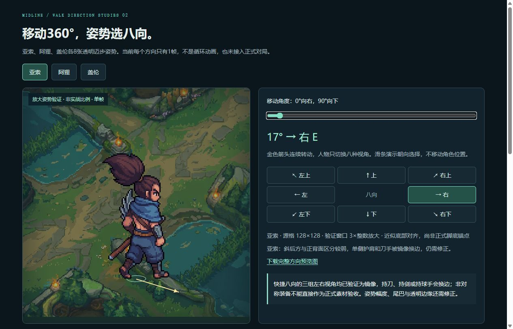

## 主方向待机与走路动画样稿

用户选择先做6条主方向样稿，随后使用项目 game-assets Skill 的 `animate-run` 像素 Standard 模式，分别为亚索、阿狸、盖伦生成右下 SE 待机和原地走路动画。6个任务均成功，未重复提交；余额1725→1515，实际消耗210积分。每条返回WebP、GIF和PNG图集，共18个声明的最终媒体文件。

逐帧读取全部12个动画文件（6条动作的两种格式），均为8帧、每帧100毫秒、总时长800毫秒，无限循环。WebP、GIF与6张PNG图集的透明度均只有0/255。图集为3×3，前8格有角色，第9格透明；亚索每格128×128，阿狸与盖伦每格256×256。原始输入文件未改动，未对像素输出重新像素化。新增只读校验脚本 `scripts/inspect-hero-animations.py`，检查声明输出与注册表完全一致，以及每帧尺寸、透明度、时长和图集空格。

逐张查看6张图集并检查48帧姿势。预览中18个媒体均加载成功；三位英雄两种动作可并排播放。暂停后逐帧确认了1→2→…→8→1的回环，以及上一帧1→8、0.5×慢放、地图与透明棋盘切换。原始WebP/GIF另设原速预览，不受主控件暂停影响。浏览器页面没有水平溢出，预览画布只使用整数最近邻放大。

新增5项动画时序与注册表测试，累计49项测试通过，项目生产构建和独立动画预览TypeScript检查通过。对局的移动、战斗、镜头与单位渲染未更改。动画目前仅一个方向，源尺寸也不是正式32×32单位规格，不声明完整八向或已接入对局。

质量风险：亚索头发和护肩细节跳动；阿狸走路中间帧向正面偏转，尾巴轮廓变化较大；盖伦步幅保守，披风和剑有少量形变。固定预览画布没有按每帧包围盒重新对齐，不掩盖潜在滑步。循环播放元数据通过不代表首尾完全无缝，后续仍需方向、实战尺寸、脚底锚点与造型稳定性验收。

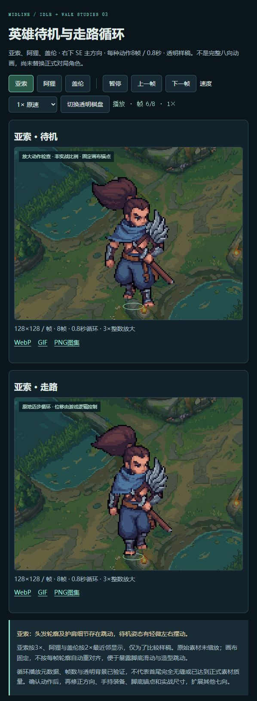

## 完整八向待机与走路扩展

按用户要求不进行美术修正，复用6条SE动画，新增其他七向42条。共三英雄×八方向×两动作=48条，384帧，144个声明的最终媒体。新增任务中一个亚索N走路任务服务端生成失败；通过原ID恢复确认终态失败与35积分全额退款后，仅补做该缺失动作并成功。实际余额11515→10045，净消耗1470积分，未对成功任务重复生成。

`scripts/inspect-eight-way-animations.py`读取全部144个声明媒体与每一帧，校验注册表与最终输出清单一致。96个WebP/GIF均为8帧、100毫秒/帧、800毫秒无限循环；48张PNG图集均为3×3、前8格非空、第9格全透明。亚索128×128、阿狸/盖伦256×256；全部透明度只有0/255，没有空帧或角色触碰画布边缘。PNG与WebP的可见像素逐帧完全一致，GIF有调色板色差。逐帧视觉检查覆盖全部384帧；源文件SHA-256未变化，未编辑最终素材。

独立预览在浏览器完成24个“英雄×方向”组合的待机与行走逐帧检查，均为1→2→…→8→1，两种动作同步且不显示第9个空格。三位英雄的每组48个原始媒体全部加载，共144个；暂停、上一帧、0.5×/2×、透明棋盘与地图背景检查通过。页面没有水平溢出，像素仅使用整数最近邻显示，观察到的控制台无警告或错误。使用独立测试页，保留用户正在查看的预览页。

新增5项八向注册表测试，累计54项测试通过；项目生产构建及v2预览独立严格TypeScript检查通过。正式对局的单位渲染、移动、战斗与镜头没有更改。源镜像关系、细节变化和部分动作的朝向/轮廓跳动按用户要求保留，不声明首尾严格无缝或已完成正式美术验收。

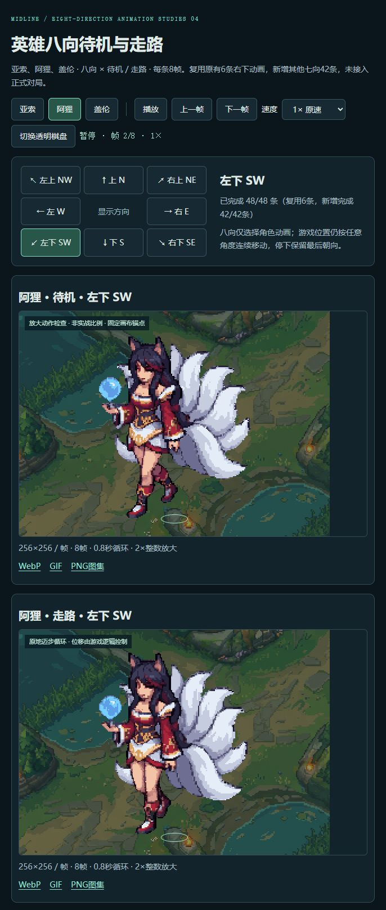

## 亚索普通攻击样稿

使用项目game-assets Skill，先编辑起手姿势，再生成一条SE朝向8帧普攻。官方参考为亚索英雄页R演示约6.0–7.2秒的近身普攻，实际逐帧观察后转为动作提示词；未将Q刺击或E冲刺作为普攻，也未声称观看被登录验证拦截的YouTube视频。两个生成任务均成功，余额10045→9985，消耗60积分。

`scripts/inspect-yasuo-attack.py`读取全部声明的普攻媒体及8帧：WebP/GIF每帧176×176、100毫秒，800毫秒无限循环；PNG为528×528的3×3图集，前8格非空、第9格透明。全部透明度只有0/255，无空帧或触碰画布边缘；PNG与WebP可见像素逐帧一致，GIF调色板有轻微色差。准备图只添加透明边距，原角色未重采样，起手输出画布176×176、脚底位置保持一致。完整视觉检查覆盖8帧，刀光偏大和首尾差异明确标注，未宣布正式美术验收。

浏览器检查8张逐帧预览、1→2→…→8→1的手动选择、0.5×慢放、透明棋盘、地图背景和原始WebP/GIF加载。实播“播放一次普攻”，确认关闭循环并在播放完毕后显示“待机 / 本次挥刀结束”，不自动再挥刀。主画布3×、逐帧与原动画2×整数最近邻，固定逻辑锚点；页面无水平溢出，检查到的控制台无警告或错误。新增4项单次攻击预览时序测试，累计58项测试通过；项目生产构建与独立预览的严格TypeScript检查通过。

本轮未更改正式对局的单位渲染、战斗数值、移动或镜头。单次播放只是素材预览，不触发游戏伤害；八向普攻、暴击、Q以及盖伦攻击不在本轮生成范围。

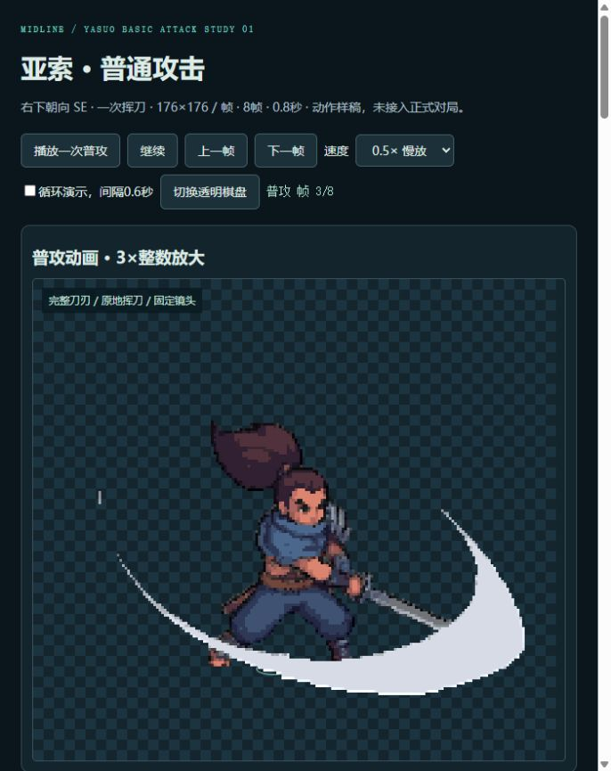

## 亚索三组 A/B 普攻衔接

使用项目game-assets Skill的姿势编辑与关键帧动画，为右下SE朝向生成3组候选：斜劈/反撩、横斩/回斩、短劈/挑刀。先检查关键姿势，并修补一张换手的回斩姿势；动画共6条、48帧、18个声明的最终媒体。8个姿势任务和6个动画任务全部成功，余额9985→9595，消耗390积分。未重复提交，也未覆盖v1。

`scripts/inspect-yasuo-ab.py`检查全部18个动画媒体。WebP/GIF均为176×176、8帧、每帧100毫秒；PNG为528×528、3×3图集，前8格非空，第9格透明。全部透明度0/255，无空帧或触碰画布边缘；PNG与WebP可见像素一致，GIF的最大平均RGB色差约0.397/255。逐帧视觉检查覆盖全部48帧和6处A/B接缝。接缝在黑色背景上的全画布平均RGB差约1.01–1.11/255，透明轮廓也有变化；共享输入姿势没有使最终生成帧严格相同，因此不声明像素级无缝。

浏览器完成三组同步16帧手动顺序检查：A1→…→A8→B1→…→B8→A1，无待机间隔或第9个透明格。上一帧、接缝跳转、第二组独立帧按钮、0.5×慢放、背景切换与原始WebP/GIF加载均检查通过。实播一次A+B，确认关闭循环并停在B8，显示“本次A+B已结束”；最终保留1×连续循环的对比页。主画布176×176显示352×352，逐帧画布1×；1265像素宽的浏览器页面无水平溢出，观察到的控制台无警告或错误。

新增5项A/B时序测试，累计63项测试通过，项目生产构建与独立预览严格TypeScript检查通过。样稿内统一持刀手，但与旧待机的持刀手一致性仍需正式接入前验收。第一组刀路区分最明显但A刀光偏宽；第二组A/B横斩相近、重心变化更大；第三组A刀光最克制，动作转折偏快。全部仍为动作设计候选，未替换正式对局单位，也未修改战斗、移动或镜头。

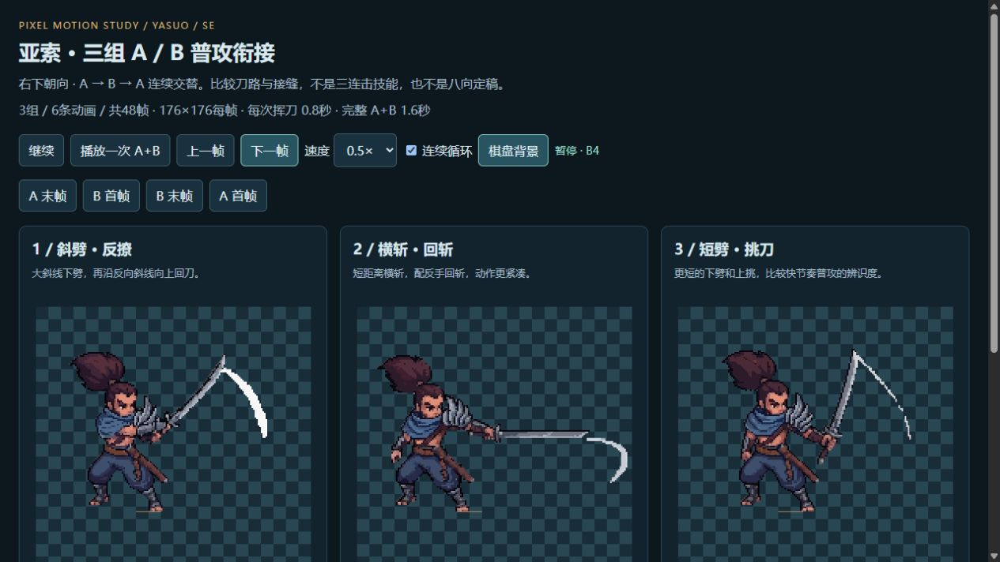

## 亚索左右横挥重新生成

用户否定旧三组后，使用项目game-assets Skill重做横挥起手和整条左右挥刀循环，不拼接独立A/B片段。起手编辑15积分，初次高帧率动画30积分，第二次Pixel Advanced动画45积分；余额9595→9505，实际90积分。全部任务以各自原ID完成，无重复提交。旧版、原英雄素材和正式对局不修改。

初次224×192、39帧、2秒结果逐帧检查后不采用：主要在两个姿势间跳变，部分左挥刀尖触边。第二次256×192、16帧、100毫秒/帧、1.6秒结果作为当前待打磨样稿。`scripts/inspect-yasuo-horizontal.py 9505 retry`校验声明的WebP、GIF及4×4 PNG图集；透明度0/255，无空帧或触边，16张PNG格与WebP可见像素一致。像素不重采样，不移动或重排生成帧。

逐帧视觉检查覆盖全部16帧，已观察到横向刀路、手臂和腰肩转动；仍有大面积白色刀光、服装细节变化、停顿和末帧回到首帧的姿势跳变。生成动作约有两轮左右挥砍，而非严格两次击中。验证记录明确区分文件技术检查通过与美术未验收，不宣布流畅自然或严格无缝。

独立浏览器预览验证手动1→2→…→16→1及上一帧1→16，0.5×播放一次后停在第16帧并显示“本次循环已结束”，没有自动再挥刀。检查首尾跳转、全部16张原始帧、棋盘/纯色背景、原始WebP/GIF加载。主画布256×192显示512×384，逐帧1×整数最近邻；页面无水平溢出，观察到的控制台无警告或错误。预览直接解码声明的WebP，不生成替代美术。新增5项时序测试，累计68项通过，生产构建及该预览独立严格TypeScript检查通过。预览仅供开发服务器查看，不宣称已进入生产对局构建。

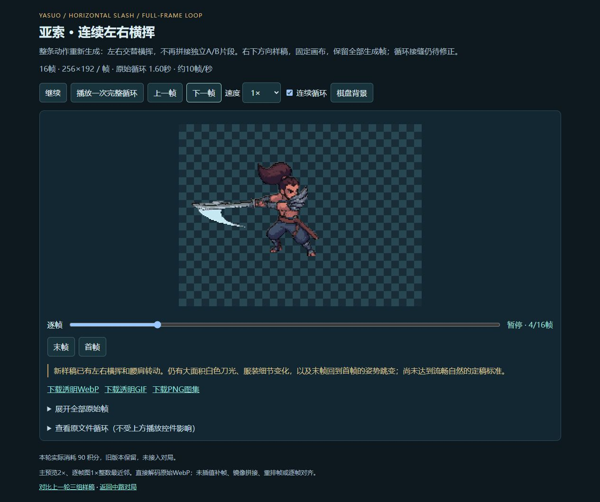

## 亚索独立斜向 A/B 普攻

按用户进一步明确的刀路，使用项目game-assets Skill制作两条独立普通攻击：A画面右下→左上斜撩，B左上→右下斜砍。重新从衣着完整的原128×128亚索开始，添加透明边距到192×192，不缩放像素。先制作低位和高位姿势，再调整高位手臂；两条首尾帧动画各73帧、3秒。首次A实际抬刀下劈后回到左上，方向错误，明确不采用；B保留。A增加胸前中间姿势，生成前将该静态姿势整体左移22像素对齐脚底，再以三张关键姿势重做12帧斜撩。没有修改返回的动画帧。

当前选用5个声明最终媒体：A透明WebP/GIF及768×576的4×3 PNG图集，12格全部有效；B透明及保留背景WebP。A12帧、100毫秒/帧、1.2秒；B73帧、3秒，前7帧42毫秒、其余66帧41毫秒。逐帧检查全部文件，透明素材只有0/255，无空帧或触边；A图集与WebP可见像素完全一致。完整视觉检查覆盖85张动作帧及替代格式；两处接缝在检查背景上的全画布平均RGB差约1.36/1.24，透明轮廓不相同，不视为严格无缝。

蓝围巾和银色护肩比v3稳定，A、B分别表现指定的上撩与下砍；但A中间姿势过渡仍偏跳，刀与刀鞘部分轮廓不够清楚，B额外生成大面积红色刀光且收刀停留较长，接缝仍有颜色和轮廓变化。本轮明确标记美术未验收，不宣布自然流畅定稿。没有将初次错误刀路A当作成功结果，也未追加更多付费尝试。

浏览器实际播放A一次、B一次、A→B一次，分别停在A12、B73、B73并显示各自结束状态。检查A12→B1、B73→A1、上一帧A1→B73，原始B时长0.5×慢放后正确停在B73。默认仅在预览中将两条各自播放速率统一到每刀1.2秒，原文件、帧数、顺序和位置不变；可切回原始时长。全部85张帧卡和4个原始动画媒体加载成功；主画布192×192显示384×384，逐帧192×192原生1×，页面无水平溢出，观察到的控制台无警告或错误。

新增7项测试，包含A/B独立结束、不同帧数衔接、预览攻速比例与实际85帧的完整时序顺序，累计75项通过；生产构建及预览独立严格TypeScript检查通过。预览仅供开发服务器查看，未接入正式对局，也未改动移动、战斗、单位渲染或镜头。余额9465→9270，实际195积分：4次姿势编辑60、2次首尾帧动画90、A关键帧动画45，全部成功，无重复付费提交。旧版及未采用A保留。

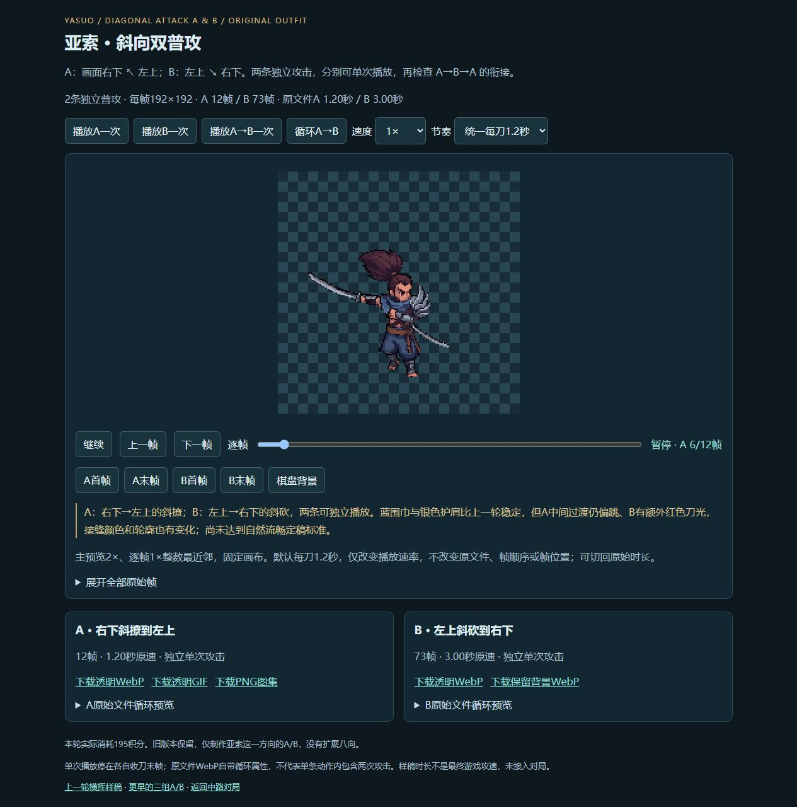
