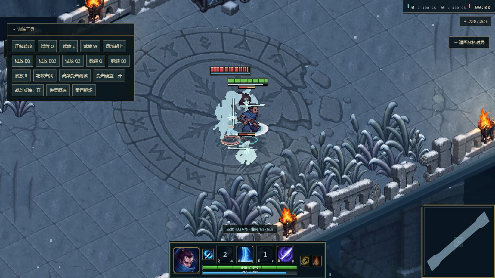
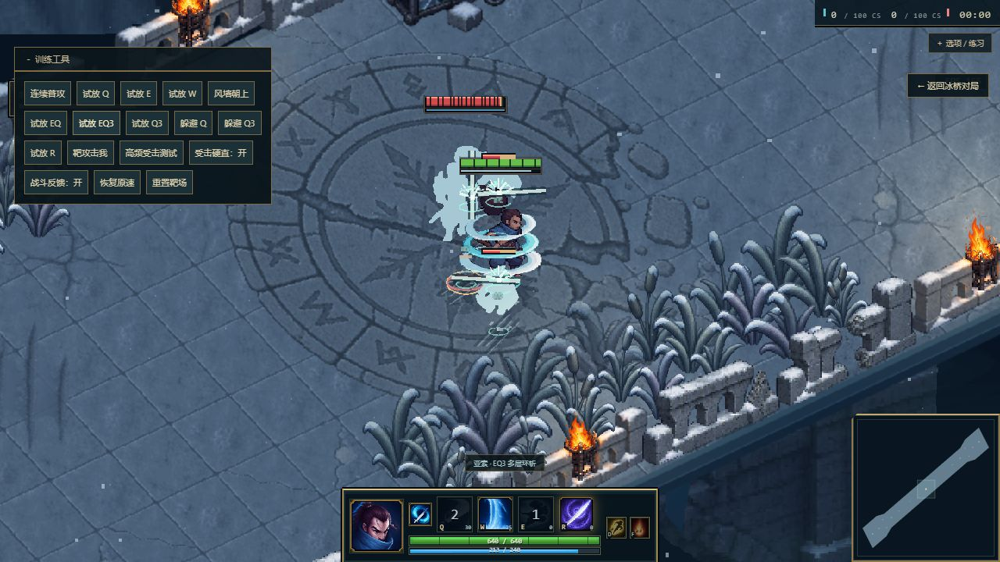

# 第一轮战斗交互验证

2026-10-15，页面 `http://127.0.0.1:5173/?map=howling&practice=combat`。

## 修改

- 普攻、Q、E、EQ 使用实际伤害事件的目标位置计算接触点，目标位移与击飞时特效跟随身体；小兵和英雄按各自身高定位。
- EQ 完整圆斩帧在 triggerAt 出现，前摇淡入、结算后衰减，不再与伤害结算相差一帧；保留原有 E 和角色动作、伤害、技能范围。
- EQ 接触斩痕沿环斩切线；EQ3 的碎风向上运动，并加入跟随受击者的风纹，普通圆斩和击飞反馈分开。
- 恢复 Q/E/EQ/Q3/EQ3 真实命中时的短音效补充：此前原始音频分流在没有命中样本时也返回“已处理”，导致补充音效不播放。保留用户的施法录音与 R 音效。
- 敌方现在同样是亚索，移除其仍指向卡牌技能的音效分支。

## 验证

- 全量 Vitest：94 个文件、548 项测试通过。新增结算同步检查覆盖 EQ/EQ3 多目标、范围外目标、击飞接触点、空放和音频补充路由。
- TypeScript 与 Vite 生产构建通过。
- 实机 0.25 倍速：EQ 和 EQ3 命中英雄后血量为 1860/2000（E 与 EQ 各结算一次），Q 后为 1915/2000。截图分别为 `eq-contact.png` 和 `eq3-contact.png`。
- 实机读取 FPS 为 165，浏览器未记录 warn/error。这是安静靶场的采样，不能等同完整对局性能基准。
- 未直接试听扬声器输出；命中声音通过路由和音频生命周期测试验证，最终混音强度仍需玩家实听反馈。

